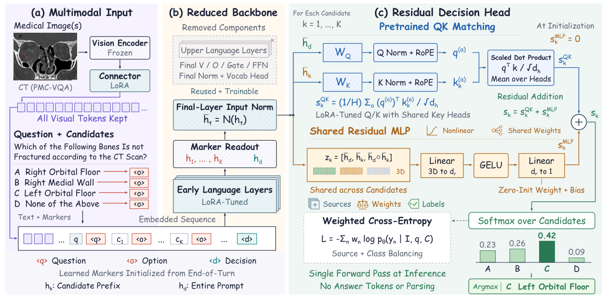
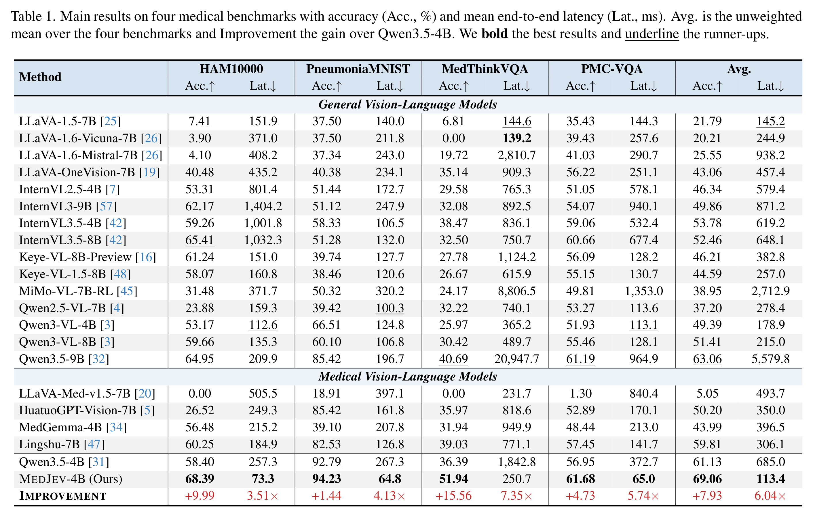
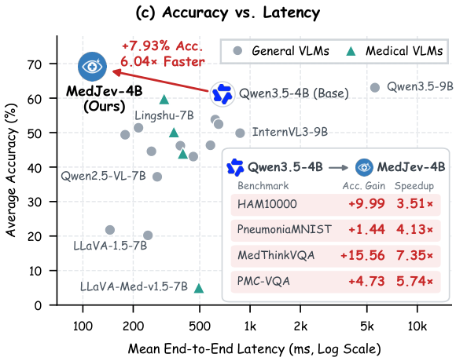

# MedJev: A System One Vision-Language Decision Model for Fast and Effective Medical Image Understanding

Official repository for the paper *MedJev: A System One Vision-Language Decision Model for Fast and
Effective Medical Image Understanding*.

MedJev-4B reads the images, the question and all candidate answers in one prompt and returns a score
for every candidate in a single forward pass. It generates no token, so there is no decoding loop and
no answer parser, and the cost of a request no longer grows with the length of a response nobody
reads.

## 🏗️ Overview

<p align="center"></p>

MedJev-4B is built on Qwen3.5-4B with two changes and nothing else.

**Language-side depth reduction.** The first 23 of the 32 language layers are kept complete, layers 24
to 31 are deleted, and from layer 32 only the query and key projections are kept. The vision encoder,
the merger topology and the language forward are untouched, and every visual token the merger produces
is kept, so a small lesion cannot be pruned away.

**Residual decision head.** A candidate is scored by the pretrained query--key geometry of the
backbone: the decision marker supplies the query, each option marker supplies a key, and the score is
their scaled dot product averaged over heads. A shared per-candidate MLP adds a residual whose output
layer is initialized to zero, so training starts from exactly the pretrained matching score and learns
only the correction.

## 📊 Main Results

Accuracy (%) and mean end-to-end latency (ms) on the four benchmarks, at batch size one on one H20,
against 20 off-the-shelf general and medical vision-language models at the 4B to 9B scale.

<p align="center"></p>

<p align="center"></p>

MedJev-4B is the only model in the top-left region: more accurate than every baseline and faster than
all but the smallest, and it improves the average accuracy of its own backbone by 7.93 points while
answering 6.04 times faster.

## 📦 Checkpoints

| Model | Backbone | Link |
| --- | --- | --- |
| MedJev-4B | Qwen3.5-4B | [🤗 Karl28/MedJev-4B](https://huggingface.co/Karl28/MedJev-4B) |

```bash
hf download Karl28/MedJev-4B --local-dir checkpoints/medjev-4b
bash scripts/evaluate.sh checkpoints/medjev-4b
```

A checkpoint is a LoRA adapter plus the marker embeddings, the residual head and the three readout
norms, which is 25,768,961 trained parameters in total. The backbone is not redistributed, so
`Qwen/Qwen3.5-4B` is downloaded at load time. `medjev.evaluate` merges the adapter before timing, so
the reported latency is not inflated by adapter arithmetic.

## 📁 Repository Layout

| Path | Content |
| --- | --- |
| `medjev/readout.py` | The query--key decision readout and the zero-initialized residual head |
| `medjev/model.py` | Markers, depth reduction, LoRA attachment, and the model builder |
| `medjev/data.py` | The closed-set record format, the prompt with its markers, and the encoder |
| `medjev/dataset.py` | Manifest reading, with images opened lazily |
| `medjev/train.py` | One epoch over the pooled training split with the weighted candidate loss |
| `medjev/evaluate.py` | One forward pass per request over the four test splits |
| `scripts/prepare_data.py` | Builds the manifests from the four public datasets |
| `scripts/train.sh`, `scripts/evaluate.sh` | Launchers that read `.env` |

The ablations, the analyses and the baselines of the paper are not part of this repository.

## 🚀 Installation

We trained with Python 3.10, CUDA 12.9, PyTorch 2.10.0, Transformers 4.60.0, PEFT 0.17.1 and
FlashAttention 2.8.3.

```bash
conda create -n medjev python=3.10 -y
conda activate medjev
pip install torch==2.10.0 --index-url https://download.pytorch.org/whl/cu129
pip install -e .
pip install flash-attn==2.8.3 --no-build-isolation
```

Copy `.env.example` to `.env` and fill in the four paths. All scripts assume the repository root as the
working directory.

## 🗂️ Data

The four benchmarks are public. Download them into `$MEDJEV_SOURCE`, then build the manifests. Every
command below was run end to end; none of the sources is gated, and none needs registration.

**HAM10000.** The dermoscopy images are the training pool and the ISIC 2018 Task 3 test set is the
labelled test split of 1,512 images. The test archive on Dataverse is missing one image, so take the
test images from ISIC.

```bash
cd $MEDJEV_SOURCE
curl -L -o HAM10000_images_part_1.zip https://dataverse.harvard.edu/api/access/datafile/3172585
curl -L -o HAM10000_images_part_2.zip https://dataverse.harvard.edu/api/access/datafile/3172584
curl -L -o HAM10000_metadata.csv "https://dataverse.harvard.edu/api/access/datafile/4338392?format=original"
curl -LO https://isic-archive.s3.amazonaws.com/challenges/2018/ISIC2018_Task3_Test_Input.zip
curl -LO https://isic-archive.s3.amazonaws.com/challenges/2018/ISIC2018_Task3_Test_GroundTruth.zip
unzip -q 'HAM10000_images_part_*.zip' -d $MEDJEV_DATA/ham10000/images
unzip -qj ISIC2018_Task3_Test_Input.zip -d $MEDJEV_DATA/ham10000/test_images
unzip -qj ISIC2018_Task3_Test_GroundTruth.zip -d .
```

**PneumoniaMNIST.** The 224 x 224 variant lives only in the MedMNIST+ record on Zenodo, not in the
v2.x records.

```bash
curl -L -o $MEDJEV_SOURCE/pneumoniamnist_224.npz \
  "https://zenodo.org/records/10519652/files/pneumoniamnist_224.npz?download=1"
```

**MedThinkVQA.** A case carries 2 to 47 images and MedJev reads all of them.

```bash
hf download bio-nlp-umass/MedThinkVQA --repo-type dataset --local-dir $MEDJEV_SOURCE/medthinkvqa
unzip -q $MEDJEV_SOURCE/medthinkvqa/images.zip -d $MEDJEV_DATA/medthinkvqa
```

**PMC-VQA.** Use version 2, whose test split holds the 33,430 questions the paper reports.

```bash
hf download RadGenome/PMC-VQA train_2.csv test_2.csv images_2.zip \
  --repo-type dataset --local-dir $MEDJEV_SOURCE/pmcvqa
unzip -q $MEDJEV_SOURCE/pmcvqa/images_2.zip -d $MEDJEV_DATA/pmcvqa
```

**Build the manifests.**

```bash
python scripts/prepare_data.py --dataset all --source $MEDJEV_SOURCE --out $MEDJEV_DATA
python -c "from medjev.dataset import describe; describe('$MEDJEV_DATA')"
```

`prepare_data.py` keeps an example only when every image of it decodes, when it offers two to seven
candidates, and when the reference answer binds to exactly one of them. It prints how many examples
each filter removed. Our runs used 174,360 training and 36,286 test examples: 9,951 / 1,512 for
HAM10000, 4,698 / 624 for PneumoniaMNIST, 7,307 / 720 for MedThinkVQA and 152,404 / 33,430 for PMC-VQA.
The test counts are the official splits and should reproduce exactly; the training counts can differ by
a few examples if a source has been revised since.

## 🏋️ Training

One epoch over the pooled training split, one optimizer, no curriculum and no second stage. The loss is
a cross-entropy over the candidates of each example, weighted so that no benchmark dominates and,
inside a classification benchmark, so that no diagnosis dominates. Our run used one H20 and took about
a day.

```bash
bash scripts/train.sh
```

The defaults are the paper's: seed 42, one epoch, global batch size 32 for 5,449 updates, learning rate
1e-4, weight decay 0.01, gradient clipping 1.0, LoRA rank 16 with scaling 32 on the backbone and the
merger, and the residual head trained at full weight with hidden width 256. Checkpoints, logs and the
final model go to `$MEDJEV_WORK/runs/medjev-4b/`.

## 🧪 Evaluation

```bash
bash scripts/evaluate.sh $MEDJEV_WORK/runs/medjev-4b/final
```

Each request is one forward pass: no token is generated and no answer is parsed, so a prediction is a
candidate index and can never fail to match a candidate. The script writes one JSONL of per-example
records per benchmark, with the probability of every candidate and the end-to-end latency, and a
`summary.json` with the accuracy, the mean and median latency, and the unweighted average. Use
`DATASETS="ham10000 pmcvqa"` to score a subset.

The timed region starts when the request arrives and ends when the decision is on the CPU, so it covers
reading and decoding the image, the processor, the host-to-device copy, the forward pass and the final
synchronisation. Run it on an idle GPU at batch size one to compare against the paper.

## 📚 Citation

Coming soon.

## 🙏 Acknowledgement

This work builds on [Qwen3.5](https://huggingface.co/Qwen/Qwen3.5-4B) and on the decision-model
interface introduced by [Jev](https://typesafe.ai/blog/introducing-system-one-models-and-jev). The
benchmarks are [HAM10000](https://doi.org/10.7910/DVN/DBW86T),
[MedMNIST](https://github.com/MedMNIST/MedMNIST),
[MedThinkVQA](https://github.com/benluwang/MedThinkVQA) and
[PMC-VQA](https://huggingface.co/datasets/RadGenome/PMC-VQA). We thank their authors for releasing them.

## 📄 License

MIT, see [LICENSE](LICENSE). The datasets keep their own licences: HAM10000 is CC BY-NC 4.0, MedMNIST is
CC BY 4.0, MedThinkVQA is CC BY-NC-SA 4.0 and PMC-VQA is CC BY-SA.
